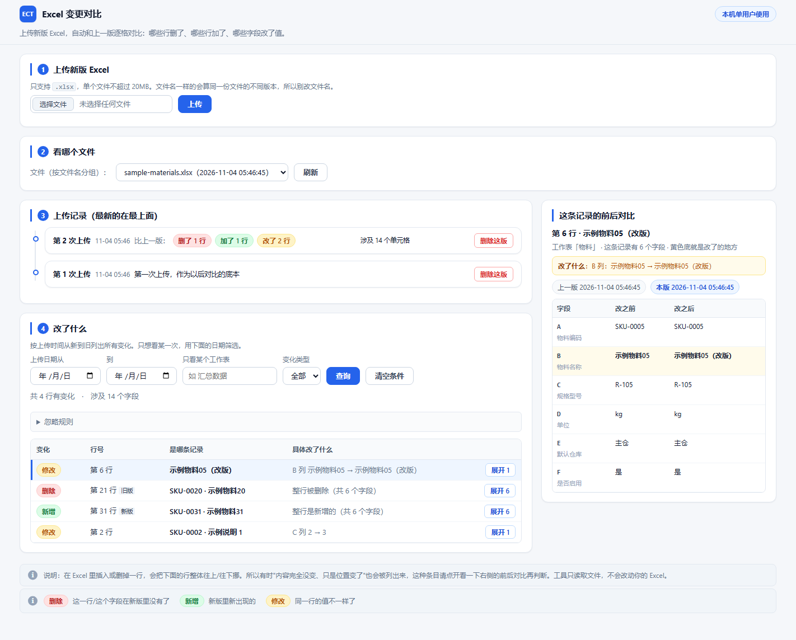

# Excel Change Tracker

**Compare two versions of the same Excel workbook and see, row by row, which records were deleted, which are new, and which fields changed value.**

Runs entirely on your machine (`127.0.0.1` only, no network calls, your files never leave the box). Built for people who check ERP / MES import templates before loading them: change the template, upload the new version, and see exactly what moved before anything is imported.

[中文说明](README.md) · [Architecture](docs/ARCHITECTURE.md)



## Why not just `diff` two xlsx files

Business spreadsheets are not source code. A naive cell-level diff produces output like:

```
deleted 156 items
  K40  kg → (empty)    L40  pcs → (empty)    M40  yes → (empty)   ... 26 fields
```

…when in fact only **6 rows** were deleted. A clerk reading "deleted 156" goes looking for 156 rows and finds nothing; `K40` means nothing to them.

What this tool does differently:

- **Aggregates by row** — one Excel record per line: `deleted · row 40 · EXAMPLE-SKU · entire row removed`
- **Counts rows, not cells** — the badge says "6 rows deleted"; the cell count is a footnote
- **Side-by-side row view** — every field of that row, before and after, changed fields highlighted, column names taken from the header row
- **Matches by identity, not position** — primary key when available, content similarity otherwise, so inserting or deleting a row doesn't flag the next 50 rows as "modified"

Search keywords: compare two Excel files · xlsx diff tool · excel diff · spreadsheet version compare · find changed rows between spreadsheets · Excel change tracking · field-level diff · audit Excel template changes

## Features

- **Primary-key-first alignment** — auto-detects a key column (composite keys up to 6 columns); duplicate keys are paired in order of appearance; if the key is unreliable (whole column rewritten, low overlap between versions) it falls back to content alignment
- **Formula comparison** — same value but `=B2*2` became `=B2*3` counts as a change; formula row-reference shifts caused by deleted rows are normalised, so you don't get thousands of phantom changes
- **Row-level pagination** — 50 rows per page, so a big deletion batch can't push the modified rows off the first screen
- **Ignore rules** — hide columns you never want to look at (`Sheet1::A`), applied at query time, reversible with one click
- **Snapshot LRU cache** — opening the row comparison doesn't re-parse a 126 MB snapshot every time
- **No network dependency** — no online service, no telemetry; Excel is read and written locally only

## Quick start

Node.js **18+** (Windows / macOS / Linux).

```bash
git clone https://github.com/elu9527-sudo/excel-change-tracker.git
cd excel-change-tracker
npm install
npm start            # opens http://127.0.0.1:3000
```

No spreadsheet at hand? Generate a synthetic pair:

```bash
npm run demo         # writes demo/第1版/sample-materials.xlsx and demo/第2版/sample-materials.xlsx
```

Upload the first version, then the second (same file name = same version line), and you'll see 4 changed rows: 2 modified, 1 deleted, 1 added.

## How to use the UI

1. **Upload the new version** — `.xlsx` only, ≤ 20 MB. Keep the file name identical: the same name means "a newer version of the same file".
2. **Pick a file** — grouped by file name.
3. **Upload history** — one card per upload: "upload #2 · 11-04 00:35 · vs previous: 1 row deleted / 1 added / 1 modified".
4. **What changed** — rows listed one per record; click any row to see the whole record before and after on the right, changed fields highlighted.

Filter by date range, sheet name, change type. The collapsible **ignore rules** panel hides columns you don't care about.

### Ignore rule syntax

`sheet:rows:cols:cells` — an empty segment means "no restriction"; supports `*`, ranges and lists:

| Rule | Meaning |
|---|---|
| `Sheet1::A` | ignore column A of Sheet1 |
| `Sheet1:1-5::` | ignore the first 5 rows |
| `*:1-3::` | ignore the first 3 rows of every sheet |
| `物料:A,C,D` | ignore columns A, C, D of sheet 物料 |
| `物料:2-100;B2:C5` | rows and cell ranges combined |

Rules live in `data/ignore_rules.json` and are applied **at query time only** — stored diffs are never rewritten. `GET /api/changes?ignore=0` returns everything.

## API

| Method | Path | Description |
|---|---|---|
| POST | `/api/upload` | Upload `.xlsx`: parse, diff against previous version, store snapshot |
| GET | `/api/version-lines` | Version lines (grouped by file name) |
| GET | `/api/timeline?version_line_id=` | Upload cards (row counts + cell counts) |
| GET | `/api/changes?version_line_id=&ignore=` | Cell-level changes (`ignore=0` disables ignore rules) |
| GET | `/api/context?snapshot_id=&row_index=&sheet_name=` | Whole-row before/after view (`other_snapshot_id` to compare against a specific version) |
| GET/POST | `/api/ignore-rules` | Read / save ignore rules |
| DELETE | `/api/snapshots/:snapshot_id` | Delete one version and its changes |
| GET | `/api/health` | Health check + API feature list |

## How it works

Three layers, each degrading gracefully instead of forcing a rule:

1. **Column alignment** — [daff](https://github.com/paulfitz/daff) maps columns; blank headers get placeholder names; missed columns are matched by content-set overlap (must be mutual best match, ties broken by closest column position).
2. **Row alignment** — with a reliable key, pair by key (coverage ≥ 90%, distinct values ≥ max(3, min(8, 30% of rows)), duplicate rate ≤ 5%, cross-version key overlap ≥ 50%). Without one, fall back to content alignment, then re-pair leftover rows when similarity ≥ 0.6 and the differing cells are a small minority (≤ max(2, 15% of columns)).
3. **Cell comparison** — value, type or formula text differing counts as a change; formulas are shifted by the paired row offset before comparing.

Changes are stored **per cell**; the row view is an aggregation done at query time, so you can drill from "row 40 was deleted" down to individual fields.

## Where data lives

Everything stays in the project directory; `data/` and `logs/` are gitignored:

```
data/version_lines/   version lines
data/snapshots/       parsed cell snapshots (JSON, ~20× the xlsx size)
data/changes/         change records
data/raw_files/       original uploads
data/ignore_rules.json
logs/app.log
```

Snapshots dominate disk usage: a 6.4 MB workbook becomes roughly a 126 MB snapshot. Delete old versions from the UI when they're no longer needed.

## Known limitations

- **Formulas are not recalculated** — only the formula text and Excel's cached value are compared.
- **Renaming a sheet** looks like "delete the whole sheet + add a whole sheet".
- **Uploading the same file twice** creates a new version with zero changes.
- **Uploads are synchronous** — parse + diff + write happen in the request; very large books take a while.
- **More than 5000 changes in one version** — the UI only fetches the first 5000.
- **Extreme row spans** (values at A1 and XFD1048576) allocate a dense rectangle and can exhaust memory.
- **Merged-cell structural changes** produce delete + add noise.

## Development

```bash
npm test        # node --test — 56 tests
npm run check   # contract check: complete constants, no hardcoded paths
npm run smoke   # end-to-end: build two versions, run the full upload pipeline
npm run demo    # generate synthetic demo workbooks
npm run portable # build dist/ECT-portable.zip (Windows, bundles node.exe)
```

## License

[MIT](LICENSE)
